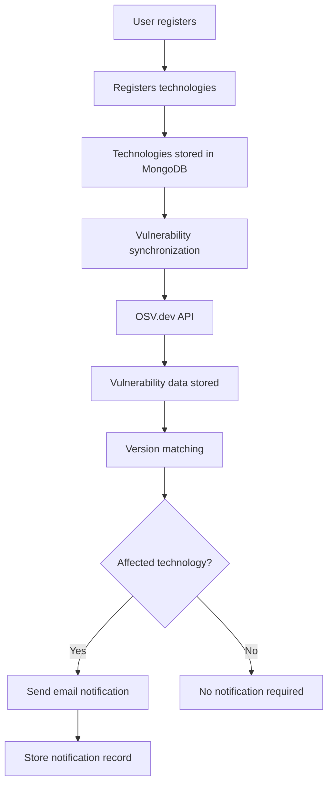

# 🌊 Nautilux

### Illuminate the digital seas.

**Open Source · Developer Intelligence**

Nautilux is an API for monitoring software vulnerabilities and helping developers keep track of the security of their technology stack.

By integrating with [OSV.dev](https://osv.dev/), Nautilux retrieves vulnerability information, checks registered software versions against known affected ranges, and notifies users when their technologies are affected.

The project brings vulnerability intelligence, technology tracking, and automated notifications together in a single API.

---

## 📑 Table of Contents

- [Overview](#-overview)
- [Features](#-features)
- [How It Works](#-how-it-works)
- [Architecture](#-architecture)
- [Technology Stack](#-technology-stack)
- [Project Structure](#-project-structure)
- [Getting Started](#-getting-started)
- [Environment Configuration](#-environment-configuration)
- [API Reference](#-api-reference)
- [Authentication](#-authentication)
- [Background Processing](#-background-processing)
- [Vulnerability Detection](#-vulnerability-detection)
- [Notification System](#-notification-system)
- [API Documentation](#-api-documentation)
- [Testing](#-testing)
- [Project Scope](#-project-scope)

---

## 🔎 Overview

Modern software applications rely on multiple third-party packages and dependencies. Although these technologies accelerate development, they can also introduce security risks.

New vulnerabilities are continuously discovered and published, making it difficult to manually track every dependency and determine whether a particular version is affected.

Nautilux addresses this problem by providing an automated vulnerability monitoring workflow.

Users can register their technologies and respective versions. Nautilux periodically retrieves vulnerability information from OSV.dev, evaluates affected versions, and sends email notifications when a registered technology matches a known vulnerability.

### Core concept

**Know your technologies. Monitor their vulnerabilities. Stay informed.**

---

## ✨ Features

### 👤 User Management
- User registration.
- User authentication.
- JWT-based authorization.
- Authenticated user profile retrieval.
- Password hashing with bcrypt.

### 📦 Technology Management
- Register software technologies.
- Associate technologies with their package ecosystem.
- Track specific software versions.
- Update registered technologies.
- Remove technologies from a user account.
- Prevent duplicate technology registrations for the same package and ecosystem.

### 🛡️ Vulnerability Intelligence
- Integration with OSV.dev.
- Vulnerability information retrieval.
- Package and ecosystem validation.
- Vulnerability synchronization.
- Software version range evaluation.
- Support for SEMVER-based affected ranges.

### 📧 Email Notifications
- Automatic vulnerability notifications.
- User-specific vulnerability matching.
- Email delivery through SMTP.
- Notification history stored in MongoDB.
- Prevention of repeated notifications for already processed matches.

### ⚙️ Background Processing
- Scheduled vulnerability synchronization.
- Scheduled notification processing.
- Automatic synchronization during application startup.
- Centralized application logging.

### ❤️ Health Checks
- Nautilux API health check.
- External service availability checks.

---

## 🔄 How It Works

The main workflow can be summarized as follows:



### Workflow explanation

1. A user creates an account and authenticates.
2. The authenticated user registers software technologies and their versions.
3. Nautilux stores the information in MongoDB.
4. The vulnerability synchronization process retrieves information from OSV.dev.
5. Vulnerability data is stored and updated locally.
6. The notification process compares registered technologies against affected package versions.
7. When a match is found, an email notification is sent to the corresponding user.
8. The notification is recorded to avoid processing the same notification repeatedly.

---

## 🏗️ Architecture

Nautilux follows a modular Node.js architecture, separating HTTP routes, business logic, database models, middleware, and background processing.

The application is organized around a service-oriented structure:

| Layer | Responsibility |
|---|---|
| Routes | HTTP endpoints and request handling |
| Services | Business rules and application logic |
| Models | MongoDB data structures and persistence |
| Middlewares | Authentication and request processing |
| Workers | Background synchronization and notifications |
| Config | Application and API documentation configuration |
| Utils | Shared utilities and logging |

This separation keeps the application organized and makes individual components easier to maintain and test.

---

## 🧰 Technology Stack

| Technology | Purpose |
|---|---|
| **Node.js** | JavaScript runtime |
| **Express.js** | HTTP server and routing |
| **MongoDB** | NoSQL database |
| **Mongoose** | MongoDB object modeling |
| **JWT** | Authentication and authorization |
| **bcrypt** | Password hashing |
| **node-cron** | Scheduled background tasks |
| **Nodemailer** | Email delivery |
| **Winston** | Application logging |
| **dotenv** | Environment configuration |
| **Semver** | Semantic version comparison |
| **Swagger / OpenAPI** | API documentation |
| **OSV.dev** | External vulnerability intelligence |

---

## 📁 Project Structure

The project uses a modular directory structure.

```text
nautilux/
│
├── config/
│   └── swagger.js
│
├── middlewares/
│   └── authentication.js
│
├── models/
│
├── routes/
│   ├── index.js
│   └── v1/
│       ├── index.js
│       ├── docs.js
│       ├── status.js
│       ├── users.js
│       └── vulnerabilities.js
│
├── services/
│
├── utils/
│
├── workers/
│   ├── email/
│   ├── notification/
│   ├── vulnerability/
│   └── scheduler.js
│
├── tests/
│
├── .env.example
├── .gitignore
├── app.js
├── server.js
└── package.json
```

*The structure above highlights the main application modules; individual files inside the modules may evolve during development.*

---

## 🚀 Getting Started

### Prerequisites

Before running Nautilux, make sure you have:

- Node.js installed.
- npm installed.
- A running MongoDB instance or MongoDB connection URI.
- An OSV.dev connection (public API).
- SMTP credentials for email delivery.

### 1. Clone the repository

```bash
git clone https://github.com/GustavoHortega/nautilux.git
```

### 2. Navigate to the project directory

```bash
cd nautilux
```

### 3. Install dependencies

```bash
npm install
```

### 4. Configure environment variables

Create your `.env` file using `.env.example` as a reference.

```bash
cp .env.example .env
```

On Windows PowerShell, you can use:

```powershell
Copy-Item .env.example .env
```

Configure the database connection, authentication secret, server port, and SMTP credentials.

### 5. Start the application

For development:

```bash
npm run dev
```

The application will start using Nodemon and initialize its database connection and background processes.

---

## 🔐 Environment Configuration

Nautilux uses environment variables to keep configuration separate from application code.

The `.env.example` file contains the variables required by the project.

Typical configuration categories include:

| Category | Description |
|---|---|
| Server | Application port |
| Database | MongoDB connection URI |
| Authentication | JWT signing secret |
| Email | SMTP host, port, credentials, and sender |
| External services | Configuration required for external integrations, if applicable |

**Important:** Never commit your actual `.env` file or expose database credentials, SMTP passwords, or JWT secrets.

---

## 🌐 API Reference

The API is versioned under the `/v1` prefix.

**Base URL:**

```text
http://localhost:3000/v1
```

### Available endpoints

#### ❤️ Status

| Method | Endpoint | Description | Authentication |
|---|---|---|---|
| GET | `/status/nautilux` | Check Nautilux API status | No |
| GET | `/status/{service}` | Check an external service | No |

#### 👤 Authentication and Users

| Method | Endpoint | Description | Authentication |
|---|---|---|---|
| POST | `/users/create` | Register a new user | No |
| POST | `/users/login` | Authenticate a user | No |
| GET | `/users/me` | Retrieve authenticated user profile | JWT |

#### 📦 Technologies

| Method | Endpoint | Description | Authentication |
|---|---|---|---|
| POST | `/users/me/technologies` | Register a technology | JWT |
| PATCH | `/users/me/technologies/{id}` | Update a registered technology | JWT |
| DELETE | `/users/me/technologies/{id}` | Remove a registered technology | JWT |

#### 🛡️ Vulnerabilities

| Method | Endpoint | Description | Authentication |
|---|---|---|---|
| POST | `/vulnerabilities` | Check vulnerabilities for a software package | No |

---

## 📌 API Usage Examples

### Register a user

`POST /v1/users/create`

```json
{
  "user": {
    "nickname": "developer",
    "email": "developer@example.com",
    "password": "StrongPassword123!"
  }
}
```

### Authenticate a user

`POST /v1/users/login`

```json
{
  "email": "developer@example.com",
  "password": "StrongPassword123!"
}
```

Successful authentication returns a JWT token.

### Retrieve the authenticated user

`GET /v1/users/me`

Header:

```http
Authorization: Bearer YOUR_JWT_TOKEN
```

### Register a technology

`POST /v1/users/me/technologies`

Header:

```http
Authorization: Bearer YOUR_JWT_TOKEN
```

Body:

```json
{
  "name": "express",
  "ecosystem": "npm",
  "version": "5.1.0"
}
```

### Update a technology

`PATCH /v1/users/me/technologies/{id}`

Header:

```http
Authorization: Bearer YOUR_JWT_TOKEN
```

Example body:

```json
{
  "name": "express",
  "ecosystem": "npm",
  "version": "5.1.1"
}
```

### Remove a technology

`DELETE /v1/users/me/technologies/{id}`

Header:

```http
Authorization: Bearer YOUR_JWT_TOKEN
```

### Check package vulnerabilities

`POST /v1/vulnerabilities`

Example body:

```json
{
  "name": "express",
  "ecosystem": "npm"
}
```

The endpoint queries vulnerability information and returns the results.

---

## 🔑 Authentication

Nautilux uses JSON Web Tokens (JWT) to protect endpoints that require an authenticated user.

### Authentication flow

1. The user registers an account.
2. The user submits their email and password to the login endpoint.
3. The application validates the credentials.
4. A JWT token is generated and returned.
5. Protected endpoints validate the token through authentication middleware.
6. The authenticated user's identifier is made available to the request handlers.

Protected requests must include:

```http
Authorization: Bearer YOUR_JWT_TOKEN
```

Passwords are hashed using bcrypt before being stored in the database.

---

## ⚙️ Background Processing

Nautilux uses background workers to automate vulnerability monitoring and notification delivery.

The background processes are separated into two main responsibilities.

### 🛡️ Vulnerability Synchronization

The vulnerability worker is responsible for retrieving vulnerability information and synchronizing it with the local database.

It communicates with OSV.dev and processes the retrieved vulnerability data.

Existing records can be updated when newer vulnerability information becomes available.

### 📧 Notification Synchronization

The notification worker processes registered users and checks whether their technologies are affected by known vulnerabilities.

It identifies pending notifications, sends the corresponding emails, and records successfully processed notifications.

### ⏰ Scheduler

The scheduler uses `node-cron` to execute automatic synchronization.

Current schedule:

| Time | Process |
|---|---|
| 03:00 | Vulnerability synchronization and notification processing |
| 15:00 | Vulnerability synchronization and notification processing |

The application also performs initial synchronization during startup.

The notification process runs after vulnerability synchronization so that the latest available vulnerability information can be evaluated.

---

## 🛡️ Vulnerability Detection

Vulnerability information is obtained from [OSV.dev](https://osv.dev/), an open vulnerability database.

Nautilux uses package information to query the OSV API.

The integration processes information such as:

- OSV vulnerability identifiers.
- Vulnerability summaries and details.
- Published and modified dates.
- Affected packages.
- Affected version ranges.
- Fixed and introduced versions.
- Vulnerability references.
- Severity information.

### Version matching

The application uses semantic version comparison to determine whether a registered technology version falls within a vulnerability's affected range.

This allows Nautilux to evaluate whether a user's specific dependency version is affected instead of simply checking whether a package has any reported vulnerabilities.

The current implementation focuses on SEMVER-based ranges.

---

## 📧 Notification System

Notifications are handled internally by background workers.

There is no dedicated HTTP notification management endpoint in the current API.

When a vulnerability matches a registered technology:

1. The notification worker identifies the affected user.
2. It retrieves pending vulnerability matches.
3. It sends an email through the configured SMTP transport.
4. It stores a notification record in MongoDB after successful delivery.

The notification records associate:

- User.
- Vulnerability identifier.
- Technology name.
- Registered technology version.

This provides a persistent record of notifications already processed.

---

## 📚 API Documentation

Nautilux uses Swagger UI and OpenAPI 3.0.3 to document its HTTP API.

The documentation is generated through `swagger-jsdoc` and served using `swagger-ui-express`.

The documentation is organized into two parts:

- **Central configuration:** shared schemas, security schemes, responses, API metadata, and reusable definitions.
- **Route-level documentation:** endpoint descriptions, request bodies, parameters, authentication requirements, and responses.

Each documented route uses `@swagger` annotations in its respective route file.

The Swagger configuration automatically scans JavaScript files under:

```text
routes/**/*.js
```

This allows new route documentation to be discovered without manually registering each file.

---

## 🧪 Testing

Nautilux includes unit and integration tests to help verify application behavior.

The tests cover important application components and workflows, helping ensure that changes do not break existing functionality.

Test execution scripts are defined in `package.json`.

---

## 🎯 Project Scope

Nautilux is focused on vulnerability monitoring for registered software technologies.

The current scope includes:

- User accounts and authentication.
- Technology registration and version tracking.
- Vulnerability retrieval and synchronization.
- Version range evaluation.
- Automated email notifications.
- Health checks.
- API documentation.

The project does not currently provide a web dashboard or a dedicated notification management API.

---

## 🌍 External Services

| Service | Purpose |
|---|---|
| [OSV.dev](https://osv.dev/) | Vulnerability information and package security data |
| SMTP Provider | Email notification delivery |
| MongoDB | Application data persistence |

---

## 📄 License

License information will be defined in the repository.

---

<p align="center">
  <strong>🌊 Nautilux</strong><br/>
  <em>Illuminate the digital seas.</em><br/><br/>
  Open Source · Developer Intelligence
</p>